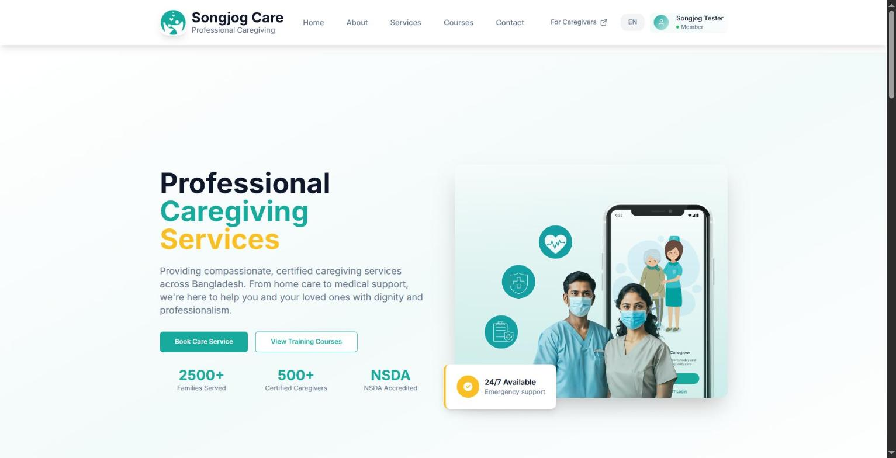
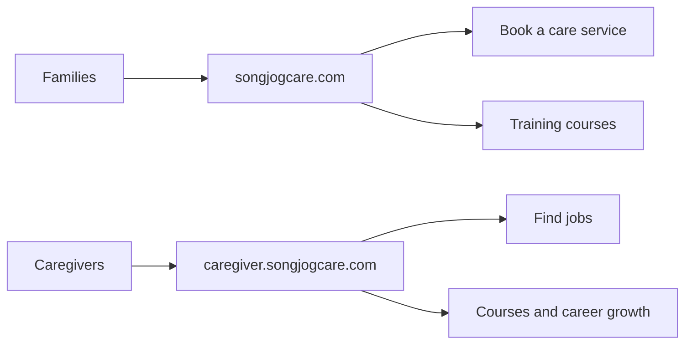
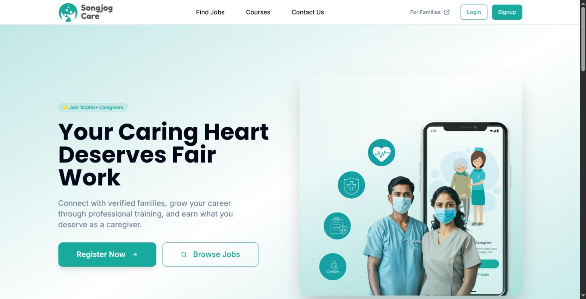

# Songjog Care Platform

Interfaces for [Songjog Care](https://songjogcare.com), the home-care service of Songjog Foundation. Families use it to find and book caregivers, and caregivers use it to find work, take training courses and grow their careers.

## Two sides, one service

## My role

- Built the full UI and frontend of both sites
- Designed the UI of the mobile app
- Planned the features and user flows with an external developer, with guidance from a senior engineer on Songjog's board
- Now writing the product specs for the next version of the platform

## Built with

TypeScript frontend · Figma for UI design

## Status

Live at [songjogcare.com](https://songjogcare.com) and [caregiver.songjogcare.com](https://caregiver.songjogcare.com). The code belongs to Songjog Foundation and is private, so this repository describes my part of the work.
